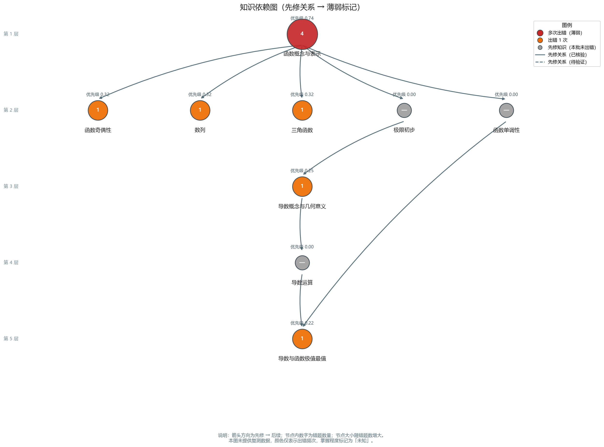
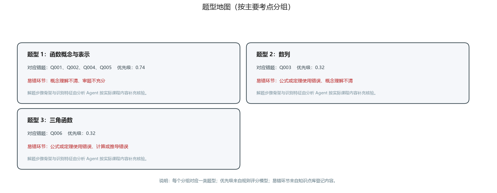

# 智能错题分析报告

> 生成时间：2026-10-17T20:55:07　|　学科：数学　|　数据来源文件：sample_questions.md
>
> 本报告由智能错题分析 Skill 自动生成。凡未提供的数据均如实标注「未知/未提供」，推测内容均标注「推测」。

---

## 一、报告基本信息

| 项目 | 内容 |
| --- | --- |
| 学科 | 数学 |
| 题目来源 | sample_questions.md |
| 题目总数 | 6 |
| 含学生作答数据 | 5 题 |
| 无学生作答数据 | 1 题 |
| 含公式题目 | 6 题 |
| 知识点匹配成功 | 6 题 |
| 知识点未匹配 | 0 题 |
| 报告生成时间 | 2026-10-17T20:55:07 |

## 二、错题整体概览

**识别问题提示（需人工核验）：**

- Q005：学生标记为「（无）」，按未提供处理

**学生作答数据覆盖情况：**

- 有学生答案/解题过程：5 题 —— 可进行具体错因分析。
- 无学生作答数据：1 题 —— 仅能分析一般性易错点，**不判断该学生的具体错误**。

## 三、主要薄弱知识点

按规则评分模型排序（分数越高越优先复习）：

| 排名 | 知识点 | 错题数 | 优先级 | 关联错题 | 掌握程度 |
| --- | --- | --- | --- | --- | --- |
| 1 | 函数概念与表示 | 4 | 0.74 | Q001、Q002、Q004、Q005 | 未知 |
| 2 | 函数奇偶性 | 1 | 0.32 | Q002 | 未知 |
| 3 | 数列 | 1 | 0.32 | Q003 | 未知 |
| 4 | 三角函数 | 1 | 0.32 | Q006 | 未知 |
| 5 | 导数概念与几何意义 | 1 | 0.25 | Q005 | 未知 |
| 6 | 导数与函数极值最值 | 1 | 0.22 | Q001 | 未知 |

**优先级指标明细（数值与来源）：**

| 知识点 | 错题频率 | 近期重复 | 错因严重度 | 先修影响 | 复测差距 |
| --- | --- | --- | --- | --- | --- |
| 函数概念与表示 | 0.67（observed） | 1.00（observed） | 0.50（missing） | 1.00（observed） | 0.50（missing） |
| 函数奇偶性 | 0.17（observed） | 0.00（observed） | 0.50（missing） | 0.50（observed） | 0.50（missing） |
| 数列 | 0.17（observed） | 0.00（observed） | 0.50（missing） | 0.50（observed） | 0.50（missing） |
| 三角函数 | 0.17（observed） | 0.00（observed） | 0.50（missing） | 0.50（observed） | 0.50（missing） |
| 导数概念与几何意义 | 0.17（observed） | 0.00（observed） | 0.50（missing） | 0.17（observed） | 0.50（missing） |
| 导数与函数极值最值 | 0.17（observed） | 0.00（observed） | 0.50（missing） | 0.00（observed） | 0.50（missing） |

> 指标来源说明：`observed` = 实际记录值；`missing` = 数据缺失，按保守值估算。归一化方式见「数据来源与不确定性说明」。

## 四、错题明细表

| 题号 | 学科相关 | 题干（摘要） | 标准答案 | 学生答案 | 状态 |
| --- | --- | --- | --- | --- | --- |
| Q001 | 函数概念与表示、导数与函数极值最值 | 已知函数 $f(x) = x^3 - 3x$，求函数的极值。 | 求导得 $f'(x) = 3x^2 - 3$，令 $f'(x) = 0$ 得 … | 极大值为 2，极小值为 -2。 | 待复习 |
| Q002 | 函数概念与表示、函数奇偶性 | 判断函数 $f(x) = x^2 + 1$ 的奇偶性。 | 定义域为 $\mathbb{R}$，关于原点对称；$f(-x) = (-x)^… | $f(-x) = -f(x)$，所以是奇函数。 | 待复习 |
| Q003 | 数列 | 已知等差数列 $\{a_n\}$ 中，$a_1 = 2$，$a_3 = 8$，求通项公式 $a_n$。 | 设公差为 $d$，$a_3 = a_1 + 2d = 8$，解得 $d = 3… | $a_n = 3n + 2$。 | 待复习 |
| Q004 | 函数概念与表示 | 函数 $f(x) = \ln(x^2 - 3x + 2)$ 的定义域是什么？ | 令 $x^2 - 3x + 2 > 0$，解得 $x < 1$ 或 $x > … | $x < 1$ 或 $x > 2$。 | 待复习 |
| Q005 | 函数概念与表示、导数概念与几何意义 | 利用导数求函数 $f(x) = x^3 - 3x$ 在区间 $[-2, 2]$ 上的最大值与最小值。 | $f'(x) = 3x^2 - 3 = 0$ 得 $x = \pm 1$。计算… | 未提供 | 待复习 |
| Q006 | 三角函数 | 求 $\sin 30^\circ + \cos 60^\circ$ 的值。 | $\sin 30^\circ = \frac{1}{2}$，$\cos 60^… | $\frac{\sqrt{3}}{2}$。 | 待复习 |

## 五、错因分析及证据

### Q001　已知函数 $f(x) = x^3 - 3x$，求函数的极值。
- **可观察到的错误**：无（未提供学生作答数据，或作答正确）

- **推测原因**：暂无法判断
- **判断依据**：证据不足
- **置信度**：低

- **是否需用户确认**：是

- **题目公式**（LaTeX 源码，共 12 个）：
  - `$f(x) = x^3 - 3x$`
  - `$f'(x) = 3x^2 - 3$`
  - `$f'(x) = 0$`
  - `$x = \pm 1$`
  - `$x < -1$`
  - `$f'(x) > 0$`
  - `$-1 < x < 1$`
  - `$f'(x) < 0$`
  - `$x = -1$`
  - `$f(-1) = 2$`
  - `$x = 1$`
  - `$f(1) = -2$`

### Q002　判断函数 $f(x) = x^2 + 1$ 的奇偶性。
- **可观察到的错误**：无（未提供学生作答数据，或作答正确）

- **推测原因**：暂无法判断
- **判断依据**：证据不足
- **置信度**：低

- **是否需用户确认**：是

- **题目公式**（LaTeX 源码，共 6 个）：
  - `$f(x) = x^2 + 1$`
  - `$\mathbb{R}$`
  - `$f(-x) = (-x)^2 + 1 = x^2 + 1 = f(x)$`
  - `$f(x)$`
  - `$-x$`
  - `$x^2 + 1$`

### Q003　已知等差数列 $\{a_n\}$ 中，$a_1 = 2$，$a_3 = 8$，求通项公式 $a_n$。
- **可观察到的错误**：无（未提供学生作答数据，或作答正确）

- **推测原因**：暂无法判断
- **判断依据**：证据不足
- **置信度**：低

- **是否需用户确认**：是

- **题目公式**（LaTeX 源码，共 9 个）：
  - `$\{a_n\}$`
  - `$a_1 = 2$`
  - `$a_3 = 8$`
  - `$a_n$`
  - `$d$`
  - `$a_3 = a_1 + 2d = 8$`
  - `$d = 3$`
  - `$a_n = 2 + (n-1) \times 3 = 3n - 1$`
  - `$a_n = 3n + 2$`

### Q004　函数 $f(x) = \ln(x^2 - 3x + 2)$ 的定义域是什么？
- **可观察到的错误**：无（未提供学生作答数据，或作答正确）

- **推测原因**：暂无法判断
- **判断依据**：证据不足
- **置信度**：低

- **是否需用户确认**：是

- **题目公式**（LaTeX 源码，共 5 个）：
  - `$f(x) = \ln(x^2 - 3x + 2)$`
  - `$x^2 - 3x + 2 > 0$`
  - `$x < 1$`
  - `$x > 2$`
  - `$(-\infty, 1) \cup (2, +\infty)$`

### Q005　利用导数求函数 $f(x) = x^3 - 3x$ 在区间 $[-2, 2]$ 上的最大值与最小值。
- **可观察到的错误**：无（未提供学生作答数据，或作答正确）

- **推测原因**：暂无法判断
- **判断依据**：证据不足
- **置信度**：低

- **是否需用户确认**：是

> ⚠️ 未提供学生答案/解题过程，本模块不判断该学生的具体错误；以下内容仅为该题的一般性易错点，不是已发生的错误。

- **题目公式**（LaTeX 源码，共 8 个）：
  - `$f(x) = x^3 - 3x$`
  - `$[-2, 2]$`
  - `$f'(x) = 3x^2 - 3 = 0$`
  - `$x = \pm 1$`
  - `$f(-2) = -2$`
  - `$f(-1) = 2$`
  - `$f(1) = -2$`
  - `$f(2) = 2$`

### Q006　求 $\sin 30^\circ + \cos 60^\circ$ 的值。
- **可观察到的错误**：无（未提供学生作答数据，或作答正确）

- **推测原因**：暂无法判断
- **判断依据**：证据不足
- **置信度**：低

- **是否需用户确认**：是

- **题目公式**（LaTeX 源码，共 5 个）：
  - `$\sin 30^\circ + \cos 60^\circ$`
  - `$\sin 30^\circ = \frac{1}{2}$`
  - `$\cos 60^\circ = \frac{1}{2}$`
  - `$\cos 60^\circ$`
  - `$\frac{\sqrt{3}}{2}$`

## 六、知识依赖图

（矢量版本：[knowledge-graph.svg](assets/knowledge-graph.svg)）

- 箭头方向：先修知识 → 后续知识。
- 节点内数字：错题数量；节点大小随错题数增大。
- 颜色：红色 = 多次出错，橙色 = 出错 1 次，灰色 = 先修知识（本批错题未涉及）。
- 本报告未提供复测数据，**掌握程度为「未知」**，颜色仅表示出错频次。

## 七、题型地图

（矢量版本：[topic-map.svg](assets/topic-map.svg)）

- 每个分组对应一类题型（按主要考点聚类）。
- 优先级来自规则评分模型；易错环节来自知识点库登记。
- 解题步骤骨架由分析 Agent 按实际课程内容补充核验，不使用通用模板冒充。

## 八、7 天个性化复习计划
**时间预算**：每日可用 60 分钟 × 安全系数 0.9 = 每日任务上限 54 分钟。复测间隔：每 3 天（保守安排，无复测反馈数据）。

### 第 1 天：基础薄弱点突破

**当日目标**：
- 突破知识点：函数概念与表示
- 完成理论回顾与错题重做

| 任务 | 类型 | 内容 | 用时 | 完成标准 |
| --- | --- | --- | --- | --- |
| 理论回顾：函数概念与表示 | theory | 复习「函数概念与表示」的定义、核心公式与常见易错点（关联错题：Q001、Q002、Q004、Q005）。先合上书回忆，再对照笔记查漏。 | 15 分钟 | 能不看资料写出该知识点的定义、公式，并说出至少 2 个易错点。 |
| 练习巩固：函数概念与表示 | practice | 重做错题 Q001、Q002、Q004、Q005，再做 1-2 道同类变式题；每道题完整写出解题步骤，不跳步。 | 30 分钟 | 独立完成错题重做且步骤完整；变式题错误能定位到具体步骤。 |

**当日合计 45 / 54 分钟**

**复盘方式**：

1. 在白纸上默写知识点框架，卡住的步骤做标记，第二天复测时优先回顾。
2. 对比标准答案，逐步标记差异点；仍不会的步骤写入「待解决问题清单」。

### 第 2 天：巩固提升与变式练习

**当日目标**：
- 突破知识点：导数与函数极值最值
- 完成理论回顾与错题重做

| 任务 | 类型 | 内容 | 用时 | 完成标准 |
| --- | --- | --- | --- | --- |
| 理论回顾：导数与函数极值最值 | theory | 复习「导数与函数极值最值」的定义、核心公式与常见易错点（关联错题：Q001）。先合上书回忆，再对照笔记查漏。 | 15 分钟 | 能不看资料写出该知识点的定义、公式，并说出至少 2 个易错点。 |
| 练习巩固：导数与函数极值最值 | practice | 重做错题 Q001，再做 1-2 道同类变式题；每道题完整写出解题步骤，不跳步。 | 30 分钟 | 独立完成错题重做且步骤完整；变式题错误能定位到具体步骤。 |

**当日合计 45 / 54 分钟**

**复盘方式**：

1. 在白纸上默写知识点框架，卡住的步骤做标记，第二天复测时优先回顾。
2. 对比标准答案，逐步标记差异点；仍不会的步骤写入「待解决问题清单」。

### 第 3 天：巩固提升与变式练习

**当日目标**：
- 突破知识点：函数奇偶性
- 完成理论回顾与错题重做

| 任务 | 类型 | 内容 | 用时 | 完成标准 |
| --- | --- | --- | --- | --- |
| 理论回顾：函数奇偶性 | theory | 复习「函数奇偶性」的定义、核心公式与常见易错点（关联错题：Q002）。先合上书回忆，再对照笔记查漏。 | 15 分钟 | 能不看资料写出该知识点的定义、公式，并说出至少 2 个易错点。 |
| 练习巩固：函数奇偶性 | practice | 重做错题 Q002，再做 1-2 道同类变式题；每道题完整写出解题步骤，不跳步。 | 30 分钟 | 独立完成错题重做且步骤完整；变式题错误能定位到具体步骤。 |

**当日合计 45 / 54 分钟**

**复盘方式**：

1. 在白纸上默写知识点框架，卡住的步骤做标记，第二天复测时优先回顾。
2. 对比标准答案，逐步标记差异点；仍不会的步骤写入「待解决问题清单」。

### 第 4 天：复测检验

**当日目标**：
- 复测前期内容（函数概念与表示、导数与函数极值最值）
- 标记真正掌握与仍需巩固的知识点

| 任务 | 类型 | 内容 | 用时 | 完成标准 |
| --- | --- | --- | --- | --- |
| 复测：函数概念与表示 | retest | 在不看资料的情况下重做此前「函数概念与表示」相关错题，检验是否真正掌握。 | 20 分钟 | 错题重做正确且能说出当时错误的原因；未掌握的回到该知识点的先修内容。 |
| 复测：导数与函数极值最值 | retest | 在不看资料的情况下重做此前「导数与函数极值最值」相关错题，检验是否真正掌握。 | 20 分钟 | 错题重做正确且能说出当时错误的原因；未掌握的回到该知识点的先修内容。 |

**当日合计 40 / 54 分钟**

**复盘方式**：

1. 记录复测结果（正确/部分正确/错误），作为下次调整复习间隔的依据。
2. 记录复测结果（正确/部分正确/错误），作为下次调整复习间隔的依据。

### 第 5 天：巩固提升与变式练习

**当日目标**：
- 突破知识点：数列
- 完成理论回顾与错题重做

| 任务 | 类型 | 内容 | 用时 | 完成标准 |
| --- | --- | --- | --- | --- |
| 理论回顾：数列 | theory | 复习「数列」的定义、核心公式与常见易错点（关联错题：Q003）。先合上书回忆，再对照笔记查漏。 | 15 分钟 | 能不看资料写出该知识点的定义、公式，并说出至少 2 个易错点。 |
| 练习巩固：数列 | practice | 重做错题 Q003，再做 1-2 道同类变式题；每道题完整写出解题步骤，不跳步。 | 30 分钟 | 独立完成错题重做且步骤完整；变式题错误能定位到具体步骤。 |

**当日合计 45 / 54 分钟**

**复盘方式**：

1. 在白纸上默写知识点框架，卡住的步骤做标记，第二天复测时优先回顾。
2. 对比标准答案，逐步标记差异点；仍不会的步骤写入「待解决问题清单」。

### 第 6 天：巩固提升与变式练习

**当日目标**：
- 突破知识点：导数概念与几何意义
- 完成理论回顾与错题重做

| 任务 | 类型 | 内容 | 用时 | 完成标准 |
| --- | --- | --- | --- | --- |
| 理论回顾：导数概念与几何意义 | theory | 复习「导数概念与几何意义」的定义、核心公式与常见易错点（关联错题：Q005）。先合上书回忆，再对照笔记查漏。 | 15 分钟 | 能不看资料写出该知识点的定义、公式，并说出至少 2 个易错点。 |
| 练习巩固：导数概念与几何意义 | practice | 重做错题 Q005，再做 1-2 道同类变式题；每道题完整写出解题步骤，不跳步。 | 30 分钟 | 独立完成错题重做且步骤完整；变式题错误能定位到具体步骤。 |

**当日合计 45 / 54 分钟**

**复盘方式**：

1. 在白纸上默写知识点框架，卡住的步骤做标记，第二天复测时优先回顾。
2. 对比标准答案，逐步标记差异点；仍不会的步骤写入「待解决问题清单」。

### 第 7 天：总复盘与查漏补缺

**当日目标**：
- 复盘全部薄弱知识点（函数奇偶性、数列）
- 整理仍未解决的问题清单

| 任务 | 类型 | 内容 | 用时 | 完成标准 |
| --- | --- | --- | --- | --- |
| 复测：函数奇偶性 | retest | 在不看资料的情况下重做此前「函数奇偶性」相关错题，检验是否真正掌握。 | 20 分钟 | 错题重做正确且能说出当时错误的原因；未掌握的回到该知识点的先修内容。 |
| 复测：数列 | retest | 在不看资料的情况下重做此前「数列」相关错题，检验是否真正掌握。 | 20 分钟 | 错题重做正确且能说出当时错误的原因；未掌握的回到该知识点的先修内容。 |

**当日合计 40 / 54 分钟**

**复盘方式**：

1. 记录复测结果（正确/部分正确/错误），作为下次调整复习间隔的依据。
2. 记录复测结果（正确/部分正确/错误），作为下次调整复习间隔的依据。

**未能排入计划的任务**（时间预算不足）：

| 任务 | 原计划用时 | 原因 |
| --- | --- | --- |
| 理论回顾：三角函数 | 15 分钟 | 每日时间预算不足，未能排入计划 |
| 练习巩固：三角函数 | 30 分钟 | 每日时间预算不足，未能排入计划 |
**计划说明**：
- 时间预算不足：2 个任务未能排入 7 天计划。建议增加每日学习时间、延长复习周期，或减少练习量。
- 以下知识点本次计划未覆盖：三角函数（时间预算限制）。

## 九、复测记录

当前未提供复测/测评数据。复测记录表待用户完成计划中的复测任务后补充。

| 日期 | 知识点 | 复测结果 | 正确/部分正确/错误 | 后续调整 |
| --- | --- | --- | --- | --- |
| （待补充） | （待补充） | （待补充） | （待补充） | （待补充） |

> 掌握良好 → 适当延长复习间隔；部分掌握 → 保持练习并安排复测；多次出错 → 回到先修知识；缺少反馈 → 维持保守安排。

## 十、后续学习建议

1. **先修优先**：优先复习「先修影响」指标高的基础薄弱点，再进入综合题与变式题。
2. **关注错因而非题量**：每道错题定位到具体错误步骤，记录「错在哪、为什么错、下次怎么检查」。
3. **补测掌握程度**：完成首轮复测后更新复测记录，系统可据此调整优先级与复习间隔。
4. **扩展知识库**：若题目未匹配到知识点（见概览），请在知识点库中补充对应条目。
5. **周期回顾**：每完成一个 7 天计划，重新运行分析，对比优先级变化。

## 十一、数据来源与不确定性说明

**数据来源**：
- 题目内容：sample_questions.md（程序提取 + Agent 识别）。
- 知识点归属：知识点库关键词匹配（启发式，标记「待确认」）+ Agent 语义标注。
- 依赖关系：知识点库已核验的先修关系；模型推断的关系一律标记「待验证」。
- 优先级：规则加权模型，权重见配置文件，全部输入指标可解释。

**归一化方式**：各指标均已归一到 [0,1]：频率=错题数/总题数；重复=min(1,(n-1)/2)；严重度=错因严重度映射均值；先修影响=被依赖数/最大被依赖数（含前置缺口加成）；复测差距缺失时取保守值。

**不确定性声明**：
- 未提供复测数据 → 掌握程度全部标记为「未知」，retest_gap 为保守估算值。
- 未提供错因标注的题目 → error_severity 标记 missing，按保守值估算。
- 模型置信度不等于真实准确率；所有「推测」内容未经学生本人确认前不得作为结论。
- 未提供学生作答数据的题目，其分析仅为该题的一般性易错点，**不是该学生已发生的错误**。

---

*本报告由智能错题分析 Skill 生成。如对识别结果有疑问，请以原始试卷为准。*
